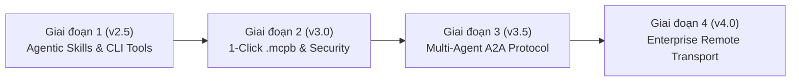

# 🚀 Lộ Trình Phát Triển Chi Tiết Canva MCP Pro (v3.0)
## Phân Tích Đối Thủ, Tích Hợp Agentic Skills & Chuẩn Hóa Hạ Tầng Enterprise

> **Dự án**: `canva-mcp-pro`  
> **Phiên bản hiện tại**: v2.0 (20 Professional MCP Tools, Hybrid Engine)  
> **Mục tiêu phiên bản**: v3.0 (Enterprise Architecture, Agentic Skills & 1-Click .mcpb Bundle)  
> **Tác giả & Chủ trì**: Lê Anh Duy & Antigravity Pair-Programming  
> **Trạng thái**: ✅ **ĐÃ THỐNG NHẤT & BẮT ĐẦU TRIỂN KHAI**

---

## 1. TỔNG QUAN CHIẾN LƯỢC & BẢNG ĐỐI SÁNH ĐỐI THỦ (COMPETITIVE BENCHMARK)

Sự bùng nổ của giao thức **Model Context Protocol (MCP)** đã chuyển hóa các MCP Server từ công cụ API wrapper đơn lẻ thành các hạ tầng tự động hóa cho AI Agent. Để định vị `canva-mcp-pro` ở vị trí dẫn đầu tuyệt đối trong lĩnh vực thuyết trình khoa học, báo cáo AI/ML và thiết kế trực quan, việc phân tích hai repository đối thủ điển hình mang lại góc nhìn chiến lược quan trọng:

| Tiêu chí Đánh giá | `universal-mcp/canva` | `vishalsachdev/canvas-mcp` | `canva-mcp-pro` (Hiện tại & v3.0) |
| :--- | :--- | :--- | :--- |
| **Ngôn ngữ & Framework** | Python 3.11+ / Universal MCP CLI (`uv`) | Python 3.11+ / FastMCP 4 / Node.js Sandbox | **TypeScript SDK v2** (`@modelcontextprotocol/server`) |
| **Quy mô MCP Tools** | Cơ bản (API wrapper thô) | 102 – 128 Tools theo Role (LMS) | **20 Tools chuyên sâu** (KPI, SWOT, Timeline, Comment Loop, Data-to-Slide) |
| **Kiến trúc Engine** | 100% Trực tiếp Cloud API | REST API + TypeScript Code Sandbox (`execute_typescript`) | **Hybrid Engine**: Local PPTX Vector (Python-pptx) + Canva Cloud Sync |
| **Tích hợp Agent Skills** | Không có | 8 Workflow Skills (`skills.sh` / `npx skills add`) | **4 Core Design Skills** (`SKILL.md`) + Tương thích Antigravity & Claude Code |
| **Đóng gói Cài đặt** | CLI (`mcp dev/install`) | 1-Click Extension Bundle (`.mcpb`) | JSON Registry + **Định hướng phát hành gói 1-Click `.mcpb`** |
| **Bảo mật & Phân quyền** | Phụ thuộc Token cá nhân | Anonymization (FERPA), PII Redaction, `confirmation_token` | **Quy chuẩn Khắt khe**: Font $\ge 24\text{ pt}$, Huy hiệu Lê Anh Duy, `confirmation_token` |
| **Kiểm thử Quality QA** | Pytest cơ bản | CI/CD GitHub Actions, Unicode Sanitization | **Bộ XML Evaluation Suite** (21 $\rightarrow$ 30 QA Pairs, 100% Pass Rate) |

---

## 2. PHÂN TÍCH CHI TIẾT 2 REPOSITORY ĐỐI THỦ

### 2.1. Phân tích `universal-mcp/canva` (Python Universal MCP)
- **Ưu điểm**:
  - Quản lý gói hiện đại qua `uv`, khởi tạo môi trường ảo nhanh.
  - Sử dụng các lệnh tiêu chuẩn `mcp dev` và `mcp install`.
- **Hạn chế lớn**:
  - **Không có Engine xử lý cục bộ**: Phụ thuộc 100% vào Canva REST API; không có khả năng tính toán tọa độ vector hay xuất bản ngoại tuyến (offline).
  - **Thiếu lớp quy tắc thẩm mỹ (Taste Rules)**: Không xử lý cỡ chữ, không chống đè văn bản, không kiểm soát lề slide hay bảng màu chuyên dụng.

### 2.2. Phân tích `vishalsachdev/canvas-mcp` (Canvas LMS MCP Server)
- **Ưu điểm Cốt lõi**:
  - **Hệ thống Agent Skills phong phú (`skills.sh`)**: Tích hợp 8 kỹ năng quy trình hướng dẫn Agent phối hợp nhiều tool thô để hoàn thành chuỗi nhiệm vụ phức tạp.
  - **Đóng gói 1-Click Extension (`.mcpb`)**: Người dùng Claude Desktop chỉ cần double-click file `.mcpb` để cài đặt mà không cần gõ lệnh terminal.
  - **Thực thi Code Cục bộ Hàng loạt (`execute_typescript`)**: Cung cấp môi trường sandbox cho phép AI tự viết script gom nhóm hàng trăm thao tác xử lý tại máy cục bộ, tiết kiệm 80% token budget.
  - **Cơ chế Bảo mật Phân vai & `confirmation_token`**: Phân chia quyền theo vai trò và bắt buộc xác nhận đối với các tác vụ ghi đè / xóa tài nguyên.
  - **Công cụ Tự Chẩn đoán CLI (`--test`, `--config`)**: Kiểm tra môi trường, API token và template trước khi AI kết nối.

---

## 3. 5 BÀI HỌC KIẾN TRÚC CHIẾN LƯỢC CHO CANVA MCP PRO

1. **Bổ sung Lớp Kỹ năng Quy trình (Agentic Skills Layer)**:
   Xây dựng 4 tệp `SKILL.md` đóng gói quy trình chuẩn mực: `canva-deck-builder`, `canva-brand-auditor`, `canva-swot-analyst`, `canva-kpi-dashboard` tương thích với Antigravity, Claude Code, Cursor và `skills.sh`.
2. **Công cụ Tự Chẩn đoán CLI (`canva-mcp-pro --test` & `--config`)**:
   Tích hợp cờ lệnh kiểm tra môi trường: xác thực Canva Access Token, kiểm tra runtime Python/Node, kiểm tra phông chữ hệ thống và tệp mẫu `Bao_Cao_Chu_De11.pptx`.
3. **Thêm Công cụ Local Code Sandbox (`canva_execute_layout_script`)**:
   Cho phép AI viết script Node.js / Python nhỏ thực thi các tác vụ căn chỉnh hình học vector hàng loạt trong thư mục `scratch`, giảm thiểu round-trip LLM tokens.
4. **Cơ chế An toàn `confirmation_token` & Annotations Đầy Đủ**:
   Gắn thẻ chú thích chuẩn Anthropic MCP SDK v2 (`readOnlyHint`, `destructiveHint`, `idempotentHint`) cho toàn bộ các công cụ; yêu cầu `confirmation_token` khi ghi đè toàn bộ slide hoặc upload Cloud.
5. **Đóng gói 1-Click Bundle (`.mcpb`)**:
   Xây dựng script tự động đóng gói dự án thành tệp `.mcpb` (manifest.json, icons, bundled JS) để người dùng có thể kéo thả cài đặt vào Claude Desktop ngay lập tức.

---

## 4. LỘ TRÌNH TRIỂN KHAI MASTER ROADMAP v3.0

### 📌 Giai đoạn 1: Agentic Skills Layer, CLI Diagnostics & Annotation Standard (v2.5)
- **Thời gian**: Thực hiện ngay lập tức.
- **Hạng mục công việc**:
  1. Thêm cờ lệnh CLI `--test` và `--config` vào [`src/index.ts`](file:///C:/Users/mrduy/.gemini/antigravity/scratch/canva-mcp-pro/src/index.ts).
  2. Bổ sung đầy đủ thẻ annotations (`readOnlyHint`, `destructiveHint`, `idempotentHint`) cho tất cả công cụ.
  3. Bổ sung Tool thứ 21: `canva_execute_layout_script` (Local Code Sandbox).
  4. Xây dựng 4 tệp Agent Skills chuyên sâu:
     - `skills/canva-deck-builder/SKILL.md`
     - `skills/canva-brand-auditor/SKILL.md`
     - `skills/canva-swot-analyst/SKILL.md`
     - `skills/canva-kpi-dashboard/SKILL.md`
  5. Mở rộng bộ XML Evaluation từ 21 lên 30 QA pairs, duy trì 100% Pass Rate.

### 📌 Giai đoạn 2: Đóng gói 1-Click (.mcpb) & Security Confirmation Token (v3.0)
- **Thời gian**: Tiếp nối sau Giai đoạn 1.
- **Hạng mục công việc**:
  1. Xây dựng script `scripts/build_mcpb.js` đóng gói bundle `.mcpb` cho Claude Desktop.
  2. Cài đặt cơ chế bảo vệ `confirmation_token` đối với các thao tác ghi đè dữ liệu hoặc xóa slide.
  3. Xuất bản tài liệu hướng dẫn cài đặt và tích hợp đa nền tảng.

### 📌 Giai đoạn 3: Chuẩn hóa Đa Agent theo Giao thức A2A Protocol (v3.5)
- **Hạng mục công việc**:
  1. Đóng gói máy chủ thành **Visual Designer Agent** theo chuẩn Linux Foundation A2A.
  2. Xuất bản Agent Card tại `/.well-known/agent.json`.
  3. Tích hợp trao đổi nhiệm vụ (Task Delegation) với Copywriter Agent và Research Agent qua JSON-RPC 2.0.

### 📌 Giai đoạn 4: Hạ tầng Đám mây & Remote Streamable HTTP Transport (v4.0)
- **Hạng mục công việc**:
  1. Hỗ trợ giao thức Streamable HTTP Transport (JSON-RPC over HTTPS/WebSocket).
  2. Đóng gói Docker Container sẵn sàng cho AWS/GCP/Render.
  3. Tích hợp xác thực OAuth 2.1 và Bearer Token cho môi trường Enterprise đa người dùng.

---

## 5. QUY TRÌNH KIỂM THỬ & TIÊU CHUẨN ĐÁNH GIÁ (QA EVALUATION)

- **Quy tắc bất biến**: Mọi nâng cấp mã nguồn phải đảm bảo:
  1. `npm run build` không có lỗi TypeScript (Zero errors).
  2. `node scripts/run_evals.js` đạt tỷ lệ **100.0% PASSED**.
  3. Phải chạy kịch bản kiểm thử tích hợp thực tế sinh slide và xác minh cỡ chữ body $\ge 24\text{ pt}$, Huy hiệu **Lê Anh Duy** ($44\text{ pt}$, Cyan `#00B0F0`).
