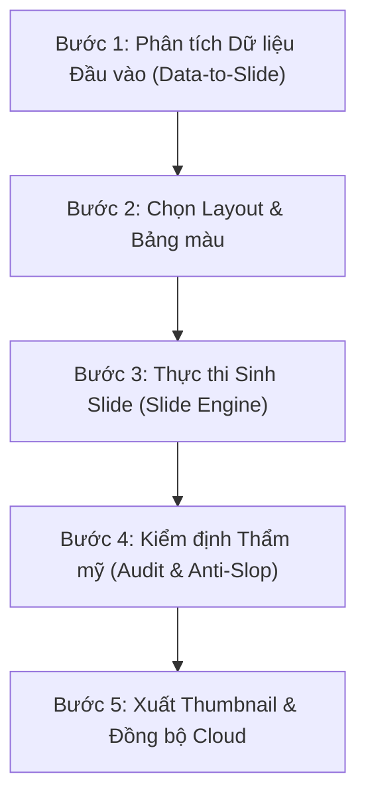

# Canva Deck Builder Skill

Kỹ năng này hướng dẫn AI Agent quy trình từng bước để xây dựng một bài thuyết trình hoàn chỉnh bằng cách phối hợp các công cụ trong `canva-mcp-pro`.

## 1. Khi nào kích hoạt kỹ năng này?
- Người dùng yêu cầu: *"Tạo slide báo cáo từ dữ liệu này"*, *"Xây dựng bài thuyết trình từ CSV/JSON"*, *"Tạo slide tiến trình"*, *"Dựng bộ slide hoàn chỉnh"*.

## 2. Quy trình điều phối 5 bước chuẩn mực:

### Bước 1: Phân tích Dữ liệu
- Sử dụng tool `canva_generate_deck_from_data` nếu người dùng cung cấp bảng số liệu hoặc tệp CSV/JSON.
- Hệ thống sẽ tự động nhận diện:
  - Chỉ số số liệu $\rightarrow$ `kpi_dashboard`
  - Điểm mạnh/yếu $\rightarrow$ `swot_matrix`
  - So sánh mô hình $\rightarrow$ `card_comparison`
  - Các bước tiến trình $\rightarrow$ `process_timeline`

### Bước 2: Bảng màu & Thương hiệu
- Luôn ưu tiên bảng màu `corporate-navy` (Màu chính: Xanh Navy `#153898`, Điểm nhấn: Vàng `#F4B400`, Phụ: Cyan `#00B0F0`).
- Nếu đề tài mang tính công nghệ/tối giản, có thể chọn `cool-white-slate` hoặc `white-link-blue`.

### Bước 3: Tiêu chuẩn Bắt buộc (Không Được Vi phạm)
1. **Cỡ chữ body text**: Luôn $\ge 24\text{ pt}$. Tuyệt đối không để cỡ chữ bị co nhỏ.
2. **Huy hiệu Người trình bày**: Bắt buộc gắn **`Lê Anh Duy`** ($44\text{ pt}$, Cyan `#00B0F0`) ở góc trên bên phải.
3. **Tiêu đề Slide**: `Bai Jamjuree Bold`, $35\text{ pt}$.

### Bước 4: Kiểm định & Sửa lỗi
- Chạy `canva_validate_slide_copy` để loại bỏ từ sáo rỗng AI slop (game-changing, revolutionary, delve, tapestry,...).
- Đọc bình luận Canva qua `canva_read_design_comments` và chạy `canva_auto_fix_from_comment` nếu có yêu cầu điều chỉnh.

### Bước 5: Xem trước Thumbnail
- Tự động xuất hình ảnh xem trước PNG Full HD (1920x1080) và chèn markdown preview `` để người dùng nghiệm thu ngay.
